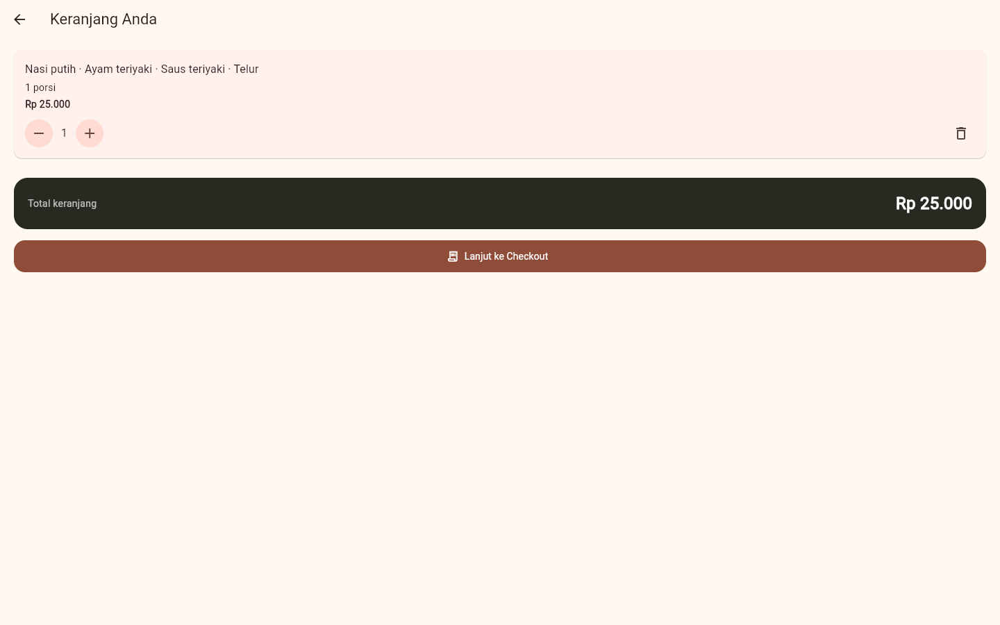
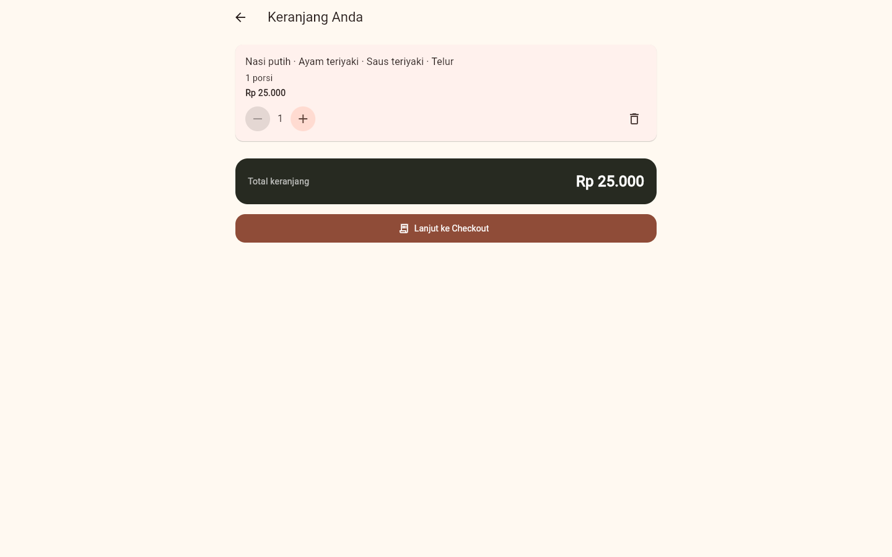
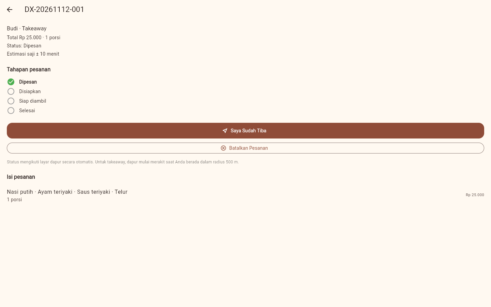
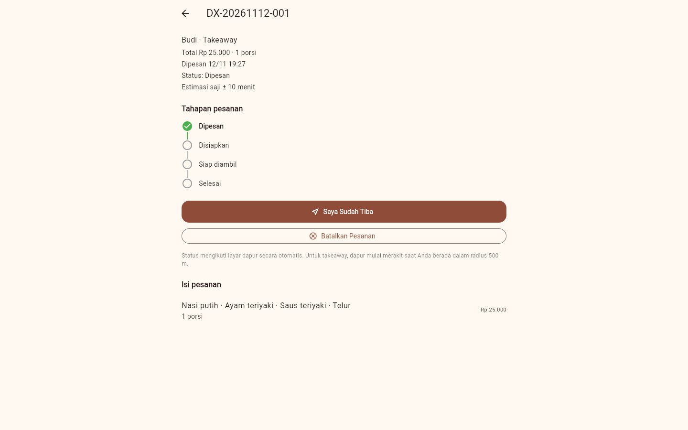
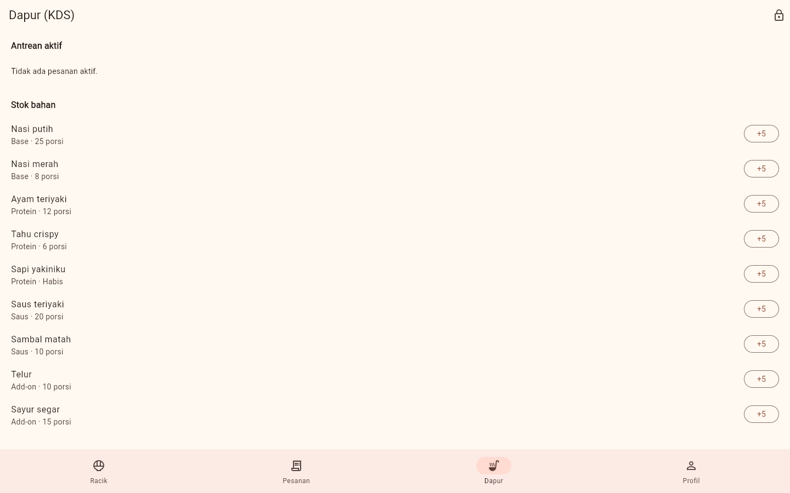
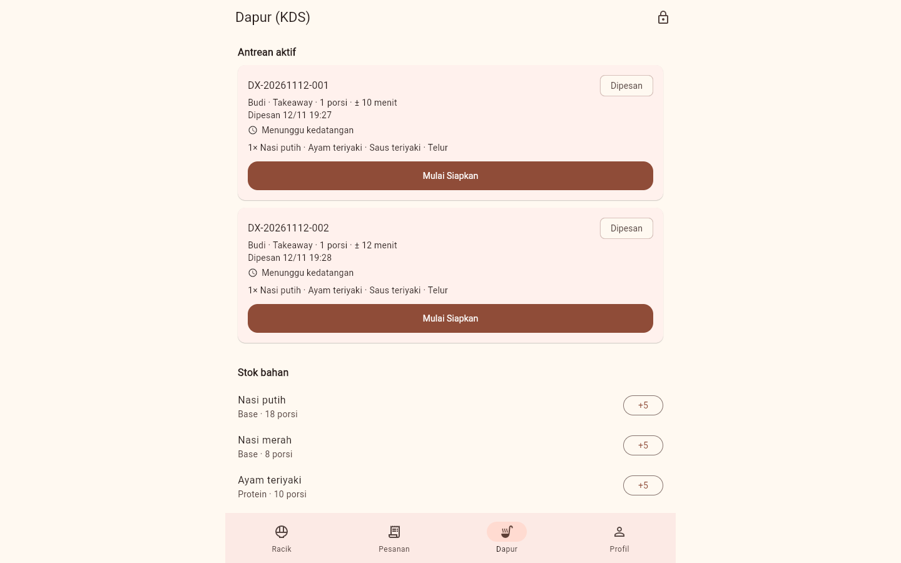

# Bug Setelah Deployment dan Penyelesaiannya — Tugas 10

Tanggal: 2026-11-12. Semua bug dicatat sebagai GitHub Issues:
<https://github.com/Cikibber/DonburiX/issues?q=is%3Aissue>.

## Cara bug ditemukan

Aplikasi yang sudah di-deploy pada Tugas 8
(<https://cikibber.github.io/DonburiX/>, build `b6f55af`) diuji ulang di
Chromium dengan tiga cara:

1. Menjalankan alur pelanggan dan dapur di jendela desktop 1440 px dan ponsel 320 px.
2. Membuka aplikasi di dua tab sekaligus, satu sebagai pelanggan dan satu sebagai dapur.
3. Memeriksa sumber halaman, `manifest.json`, header, dan aset yang disajikan server.

Ditemukan 13 bug. Tiap bug direproduksi di situs langsung sebelum dicatat.

## Daftar issue

| Issue | Tingkat | Bug | Penyebab | Perbaikan |
| --- | --- | --- | --- | --- |
| [#3](https://github.com/Cikibber/DonburiX/issues/3) | Tinggi | Pesanan hilang dan antrean dapur tidak ter-update saat aplikasi dibuka di dua tab | Tiap tab hanya membaca `localStorage` saat dibuka, lalu menimpanya dengan salinan lama | Data disinkronkan dari penyimpanan sebelum setiap perubahan dan diperiksa tiap 2 detik |
| [#4](https://github.com/Cikibber/DonburiX/issues/4) | Sedang | Tampilan melebar penuh di layar desktop | Hanya layar Racik dan Masuk yang dibatasi lebarnya | Lebar seluruh aplikasi dibatasi 720 px dan ditaruh di tengah |
| [#5](https://github.com/Cikibber/DonburiX/issues/5) | Sedang | "Lacak Pesanan" membuka layar Pesanan tanpa navigasi bawah | Layar Pesanan didorong sebagai halaman baru | Kembali ke layar utama dengan tab Pesanan terpilih |
| [#6](https://github.com/Cikibber/DonburiX/issues/6) | Sedang | Pesanan langsung batal tanpa konfirmasi | Tombol langsung memanggil pembatalan | Dialog konfirmasi "Batalkan pesanan?" |
| [#7](https://github.com/Cikibber/DonburiX/issues/7) | Rendah | Tombol kurangi di keranjang menampilkan error pada 1 porsi | Tombol tetap aktif di batas jumlah | Tombol nonaktif pada 1 dan 10 porsi |
| [#8](https://github.com/Cikibber/DonburiX/issues/8) | Rendah | Nama pemesan di Checkout tidak terisi dari akun | Form selalu mulai kosong | Nilai awal diambil dari nama akun |
| [#9](https://github.com/Cikibber/DonburiX/issues/9) | Rendah | Halaman kosong saat aplikasi dimuat | `index.html` tidak berisi apa pun selain skrip | Indikator "Memuat DonburiX…", pesan `<noscript>`, dan `theme-color` |
| [#10](https://github.com/Cikibber/DonburiX/issues/10) | Rendah | Metadata halaman masih menyebut prototype tugas ke-4 | Teks templat lama | Deskripsi dan judul diperbarui di `index.html` dan `manifest.json` |
| [#11](https://github.com/Cikibber/DonburiX/issues/11) | Rendah | Favicon dan ikon PWA masih logo Flutter | Ikon templat tidak pernah diganti | Ikon DonburiX dari `web/icons/icon.svg` |
| [#12](https://github.com/Cikibber/DonburiX/issues/12) | Sedang | Pesanan ke-1000 dalam sehari gagal setelah stok terpotong | Nomor urut diperiksa setelah reservasi stok | Batas 999 diperiksa lebih dulu dan ditolak dengan pesan yang jelas |
| [#13](https://github.com/Cikibber/DonburiX/issues/13) | Rendah | Garis penghubung tahapan pesanan tidak terlihat | Garis dibuat dari teks `│` yang terpotong | Garis digambar sebagai kotak 2 px |
| [#14](https://github.com/Cikibber/DonburiX/issues/14) | Rendah | Pesan penguncian PIN selalu "1 menit" | Teks pesan tetap | Pesan menampilkan sisa detik |
| [#15](https://github.com/Cikibber/DonburiX/issues/15) | Rendah | Waktu pemesanan tidak ditampilkan | `createdAt` tidak pernah dipakai di UI | Jam pemesanan di daftar, detail, dan kartu dapur |

Semua perbaikan ada di [PR #16](https://github.com/Cikibber/DonburiX/pull/16).
Issue tertutup otomatis saat PR digabung ke `main`.

## Bukti pengujian

### Unit dan widget test

File: [`apps/mobile/test/post_deploy_test.dart`](../../apps/mobile/test/post_deploy_test.dart),
11 test. Nama test memuat nomor issue.

| Tahap | Hasil |
| --- | --- |
| Sebelum perbaikan | 10 dari 10 test gagal pada kode `main` |
| Sesudah perbaikan | 11 dari 11 lulus (satu test sinkronisasi ditambahkan bersama perbaikan #3) |
| Seluruh aplikasi | **114 test lulus**, coverage baris 95,1% (1254/1318) |
| `flutter analyze` | No issues found |
| CI pada PR #16 | `bowl-builder`, `security-scan`, `demo-apk` berhasil ([run 43219072868](https://github.com/Cikibber/DonburiX/actions/runs/43219072868)) |

Dua test lama diubah karena memang menguji perilaku lama: test keranjang
"jumlah di bawah 1" (#7) dan test "checkout wajib nama" (#8).

Issue #9, #10, dan #11 berada di `web/` dan tidak bisa diuji dengan
`flutter test`, jadi diuji di browser.

### Uji browser pada build release

Build release dengan perbaikan disajikan lokal, lalu diuji di Chromium 1440 px:

```text
PASS #9 indikator memuat tampil
PASS #9 indikator hilang setelah aplikasi tampil
PASS #10 metadata diperbarui
PASS #11 favicon bukan bawaan Flutter (917 byte) :: 698 byte
PASS #7 tombol kurangi nonaktif di 1 porsi
PASS #8 pesanan dibuat tanpa mengetik nama
PASS #5 Lacak Pesanan: tab Pesanan terpilih dengan navigasi
PASS #15 jam pemesanan di daftar
PASS #15 jam pemesanan di detail
PASS #13 karakter garis tidak dibacakan
PASS #6 dialog konfirmasi tampil, pesanan belum batal
PASS #6 "Tidak" mempertahankan pesanan
PASS #3 dapur melihat pesanan 001
PASS #15 jam pemesanan di kartu dapur
PASS #3 pesanan 002 dibuat di tab pelanggan
PASS #3 dapur di tab lain menampilkan 002 tanpa muat ulang
PASS #3 stok dapur ikut ter-update (nasi putih 18)
PASS #3 restok dapur tidak menimpa pesanan :: {"n":2,"rice":23,"seq":2}
PASS #3 status dari dapur sampai ke tab pelanggan
PASS #14 pesan penguncian menampilkan sisa detik :: Coba lagi dalam 56 detik
PASS #12 pesanan ke-1000 ditolak dengan pesan jelas, stok utuh :: ayam 10 -> 10
PASS tanpa error konsol / pelanggaran CSP
```

Issue #4 dan isi kolom nama pada #8 diperiksa lewat tangkapan layar, karena
lebar dan isi kolom tidak terbaca dari pohon aksesibilitas Flutter.

| Sebelum | Sesudah |
| --- | --- |
|  |  |
|  |  |
|  |  |

Tambahan: [dialog konfirmasi batal](screenshots/after-cancel-dialog.png) dan
[checkout dengan nama terisi serta pesan batas 999](screenshots/after-checkout.png).

## Batasan yang masih ada

- Sinkronisasi antar tab (#3) memakai pemeriksaan tiap 2 detik dan aturan
  "penulis terakhir menang". Dua tab yang mengubah data pada saat yang persis
  sama masih bisa bertabrakan. Solusi penuhnya adalah backend.
- Sinkronisasi hanya berlaku antar tab di browser yang sama. Perangkat berbeda
  tetap tidak berbagi data, sesuai risiko R3 di Tugas 8.
- Sesi masuk belum disinkronkan: keluar di satu tab tidak mengeluarkan tab lain.
- Ikon launcher Android masih bawaan Flutter. Issue #11 hanya mencakup web.
